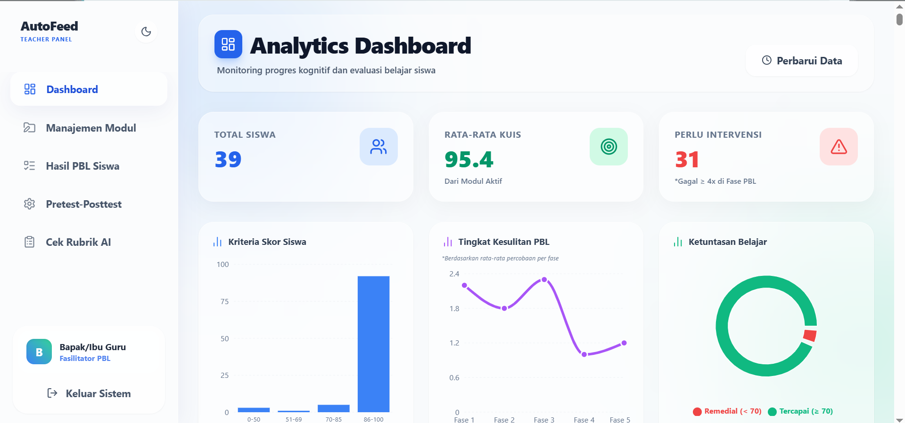
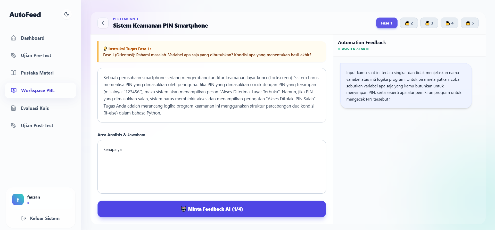

<div align="center">

# 🚀 AutoFeed
### *Intelligent Problem-Based Learning Platform with Socratic AI Tutor*

[](https://react.dev/)
[](https://fastapi.tiangolo.com/)
[](https://tailwindcss.com/)
[](https://www.python.org/)
[](https://vitejs.dev/)
[](LICENSE)

<p align="center">
  <b>AutoFeed</b> adalah platform pembelajaran pemrograman Python berbasis <i>Problem-Based Learning</i> (PBL) yang dilengkapi dengan <b>Automation Feedback AI Tutor</b>. Sistem ini menerapkan pendekatan <i>Socratic Questioning</i> dan <i>Hybrid Feedback</i> untuk menstimulasi nalar kritis dan pemecahan masalah siswa tanpa memberikan kode solusi secara instan.
</p>

[Fitur Utama](#-fitur-utama) •
[Tangkapan Layar](#-tangkapan-layar) •
[Alur Pedagogi PBL & AI](#-alur-pedagogi-pbl--ai-tutor) •
[Teknologi](#-teknologi-yang-digunakan) •
[Instalasi](#-panduan-instalasi)

---

</div>

## 📸 Tangkapan Layar

### 1. Panel Guru — Analytics Dashboard
Dashboard interaktif bagi guru / fasilitator untuk memantau progres kognitif dan evaluasi belajar siswa secara menyeluruh, tingkat kesulitan per fase PBL, distribusi nilai, serta sistem peringatan dini untuk siswa yang memerlukan intervensi belajar.

<div align="center">
  
</div>

<br/>

### 2. Panel Siswa — Workspace Problem-Based Learning (PBL)
Ruang kerja terstruktur bagi siswa untuk menyelesaikan skenario masalah melalui 5 fase PBL. Siswa berinteraksi dengan asisten AI tutor adaptif yang memberikan bimbingan reflektif dan korektif secara langsung.

<div align="center">
  
</div>

---

## ✨ Fitur Utama

### 👨‍🎓 Portal Siswa
- **5-Fase Problem-Based Learning (PBL) Terstruktur**:
  1. **Fase 1: Orientasi Masalah** – Memahami deskripsi kasus, mengidentifikasi variabel yang dibutuhkan, dan menentukan kondisi luaran.
  2. **Fase 2: Organisasi Belajar** – Merancang struktur algoritma dan alur logika berpikir pemecahan masalah.
  3. **Fase 3: Penyelidikan Mandiri** – Mengimplementasikan kode program Python berdasarkan rancangan logika.
  4. **Fase 4: Pengembangan & Penyajian** – Menguji, memvalidasi, dan menyajikan hasil program.
  5. **Fase 5: Analisis & Evaluasi** – Menjelaskan logika solusi secara mendalam dan melakukan evaluasi proses.
- **Automation Feedback (AI Tutor Sokratik)**:
  - Bimbingan cerdas menggunakan teknik *Socratic Questioning*.
  - **Zero-Spoiler Policy**: AI dilarang memberikan potongan kode solusi secara langsung demi melatih kemandirian berpikir kritis siswa.
  - **Delayed Gratification**: Penundaan validasi absolut hingga pemahaman logika siswa benar-benar teruji.
- **Compiler & Console Python Interaktif**: Menjalankan kode program Python secara langsung di browser dan menampilkan luaran *compiler* secara *real-time*.
- **Pustaka Materi & Evaluasi Kuis**: Modul pembelajaran komprehensif beserta latihan kuis pilihan ganda interaktif.
- **Pre-Test & Post-Test**: Pengukuran peningkatan kemampuan berpikir komputasional dan pemahaman materi (N-Gain).

### 👩‍🏫 Portal Guru / Fasilitator
- **Analytics Dashboard Real-time**:
  - Statistik total siswa, rata-rata skor kuis, dan tingkat ketuntasan belajar.
  - Grafik distribusi kriteria skor siswa.
  - Grafik tingkat kesulitan per fase PBL berdasarkan frekuensi percobaan siswa.
  - Diagram lingkaran ketuntasan belajar (Tercapai vs Remedial).
- **Early Intervention Alert**: Deteksi otomatis siswa yang mengalami kesulitan (gagal $\ge 4$ kali percobaan pada fase PBL) agar guru dapat segera memberikan pendampingan tatap muka.
- **Manajemen Modul & Studi Kasus**: Pengelolaan materi ajar, studi kasus tantangan PBL, dan rubrik penilaian setiap fase.
- **Monitoring Hasil PBL Siswa**: Rekap detail alur penyelesaian masalah siswa, riwayat analisis verbal, kode yang dikirimkan, serta respon AI tutor.
- **Pengaturan Ujian**: Konfigurasi bank soal untuk Pre-Test dan Post-Test.

---

## 🧠 Alur Pedagogi PBL & AI Tutor

AutoFeed menerapkan protokol **Hybrid Feedback** cerdas:

```
                        ┌──────────────────────────────┐
                        │    Input Siswa (Teks/Kode)   │
                        └──────────────┬───────────────┘
                                       │
                         [ Evaluasi Kendala Teknis? ]
                                      / \
                                     /   \
                             (Ya)   /     \  (Tidak)
                                   v       v
            ┌───────────────────────────┐ ┌───────────────────────────┐
            │  Umpan Balik KOREKTIF     │ │  Umpan Balik REFLEKTIF    │
            │  - Diagnosis lokasi error │ │  - Pertanyaan Sokratik    │
            │  - Penjelasan aturan sintaks│ │  - Stimulasi nalar logis │
            │  - Tanpa spoiler kode     │ │  - Refleksi bertahap      │
            └───────────────────────────┘ └───────────────────────────┘
```

---

## 🛠 Teknologi yang Digunakan

### Frontend
- **Core**: [React 19](https://react.dev/) & [Vite](https://vitejs.dev/)
- **Styling**: [Tailwind CSS](https://tailwindcss.com/)
- **Icons**: [Lucide React](https://lucide.dev/)
- **Charts & Data Visualization**: [Recharts](https://recharts.org/)
- **Motion & UI Animation**: [Framer Motion](https://www.framer.com/motion/)
- **Routing & Feedback**: [React Router DOM](https://reactrouter.com/) & [React Hot Toast](https://react-hot-toast.com/)

### Backend
- **Framework**: [FastAPI](https://fastapi.tiangolo.com/) (Python)
- **Web Server**: [Uvicorn](https://www.uvicorn.org/)
- **Database**: [MySQL](https://www.mysql.com/) (`mysql-connector-python`)
- **AI Integration**: Dinoiki / OpenAI-compatible Chat Completion API
- **Code Execution**: Sandboxed Python Subprocess Engine

---

## 📁 Struktur Direktori

```text
autofeed/
├── backend/
│   ├── main.py              # Endpoint API FastAPI (Auth, PBL, Compiler, Analytics)
│   ├── prompts.py           # System Prompt AI Sokratik & Hybrid Feedback
│   ├── requirements.txt     # Dependensi backend Python
│   └── ...
├── frontend/
│   ├── src/
│   │   ├── layouts/         # Layout Guru & Siswa
│   │   ├── pages/
│   │   │   ├── guru/        # DashboardGuru, ManajemenModul, HasilPengerjaan, PengaturanUjian
│   │   │   └── siswa/       # DashboardSiswa, WorkspacePBL, Materi, Kuis, UjianSiswa
│   │   ├── components/      # Komponen antarmuka pengguna
│   │   ├── App.jsx          # Sistem routing dan protected routes
│   │   └── main.jsx         # Entry point React
│   ├── package.json
│   └── vite.config.js
├── screenshots/
│   ├── teacher-dashboard.png# Tangkapan layar Analytics Dashboard Guru
│   └── student-workspace.png# Tangkapan layar Workspace PBL Siswa
└── README.md
```

---

## 🚀 Panduan Instalasi

### 1. Kloning Repositori
```bash
git clone https://github.com/Sifafauzan20/Autofeed.git
cd Autofeed
```

### 2. Konfigurasi Backend (FastAPI)
```bash
cd backend

# Buat dan aktifkan virtual environment (opsional)
python -m venv venv
# Windows:
venv\Scripts\activate
# Linux/macOS:
source venv/bin/activate

# Instal dependensi
pip install -r requirements.txt

# Siapkan file .env pada folder backend/ dengan konfigurasi database & API Key:
# DB_USER=root
# DB_PASSWORD=password_db_anda
# DB_NAME=nama_database
# DINOIKI_API_KEY=api_key_anda

# Jalankan server backend
uvicorn main:app --reload --port 8000
```

### 3. Konfigurasi Frontend (React + Vite)
Buka terminal baru di folder proyek:
```bash
cd frontend

# Instal dependensi modul Node
npm install

# Jalankan server development
npm run dev
```

Aplikasi web dapat diakses melalui browser di `http://localhost:5173`.

---

## 📄 Lisensi
Proyek ini dikembangkan untuk kebutuhan riset dan pembelajaran. Bebas digunakan dan dikembangkan di bawah lisensi terbuka.

